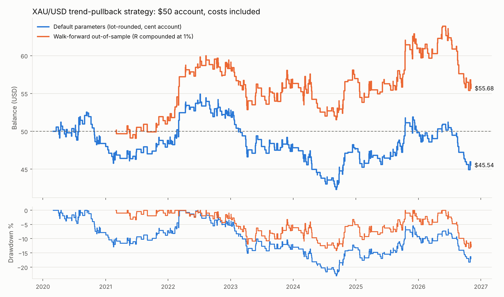

# GoldBot: XAU/USD signal generator (signal-only)

GoldBot generates rule-based gold (XAU/USD) trade signals for **manual** trading.
It **never places trades and never connects to a broker for execution**.

> **Status: phase 1 (data layer, strategy, backtest) is done. Phase 2 (WhatsApp delivery,
> live runner, paper tracking) waits for approval of the backtest results below.**
>
> **Bottom line: the strategy has no proven edge after costs.** Do not trade it with
> real money. See [Backtest results](#backtest-results).

## Contents
- [Setup](#setup)
- [Project layout](#project-layout)
- [Data](#data)
- [How the strategy works](#how-the-strategy-works)
- [Risk management for a $50 account](#risk-management-for-a-50-account)
- [Backtest method](#backtest-method)
- [Backtest results](#backtest-results)
- [WhatsApp delivery (phase 2)](#whatsapp-delivery-phase-2)
- [Limitations](#limitations)

## Setup

```bash
python3 -m venv .venv && . .venv/bin/activate
pip install -r requirements.txt
cp .env.example .env          # then put your Twelve Data key in .env
python -m goldbot fetch       # backfills 15m/1h/4h candles from 2020 (about 70 API calls, ~10 min)
python -m goldbot backtest    # full validation; writes reports/backtest_report.md and the chart
python -m pytest -q           # unit tests
```

All parameters live in [`config.toml`](config.toml). Secrets live only in `.env`.

## Project layout

```
config.toml                 every tunable parameter
data/news_calendar.csv      NFP / CPI / FOMC dates 2023-2027 (official BLS + Fed sources)
goldbot/
  data/provider.py          CandleProvider interface (swap data sources here)
  data/twelvedata.py        Twelve Data implementation
  data/ratelimit.py         per-minute + persisted per-day request budget
  data/cache.py             SQLite candle cache
  data/service.py           sync, cleaning (weekends/closures), gap reports, staleness check
  market_hours.py           spot gold trading hours (DST-aware)
  indicators.py             EMA, RSI (Wilder), ATR (Wilder), MACD, fractal swings
  strategy.py               the rules, one place
  sessions.py               London / New York windows
  news.py                   pluggable news filter (static CSV, ForexFactory weekly feed)
  risk.py                   position sizing, account types, daily limits, balance file
  backtest/                 engine, metrics, walk-forward, report
tests/                      indicators, sizing, risk rules, execution rules
reports/                    backtest report, equity chart, trade lists
```

## Data

- **Provider:** [Twelve Data](https://twelvedata.com/docs/market-data/time-series), Basic (free) plan.
  Checked 2026-11-14: 8 credits/minute, 800/day, 1 credit per `time_series` call, up to 5000
  bars per call. XAU/USD is included on the free plan, with 15m history back to January 2020.
- The bot budgets **7/minute and 780/day** (config) and persists the daily count in SQLite.
- Twelve Data returns the *latest* 5000 bars of an over-wide date range, so backfills page
  in windows that can never hold more than 5000 bars.
- **Cleaning:** only fully closed candles are stored. Candles stamped while spot gold is
  closed (Fri 17:00 to Sun 18:00 New York, plus the daily 17:00-18:00 NY break) are dropped,
  because the feed publishes flat synthetic bars on weekends. Gaps are reported, never
  forward-filled. About 2% of expected 15m bars are missing, mostly holidays.
- **Swapping providers:** subclass `CandleProvider` in `goldbot/data/provider.py`, register it
  in `goldbot/data/providers.py`, and set `[data].provider`.
- Dukascopy's free history was blocked from the build server. Yahoo only has COMEX futures
  (not spot) and 60 days of 15m data, so neither was used.

## How the strategy works

Everything is a fixed rule. There is no machine learning. Long rules are below; shorts are the exact mirror.

1. **Trend filter:** on both the last *closed* 4h and 1h bars, EMA50 > EMA200 and close > EMA50.
2. **Pullback:** within the last 6 15m bars, price came within 0.25 ATR of the 15m EMA21, and
   RSI(14) dipped to 45 or lower.
3. **Momentum trigger:** the signal bar closes above EMA21 as a bullish candle and RSI crosses
   back above 50. MACD is available as an alternative (`momentum = "macd"`).
4. **Structure:** the pullback low (lowest low of the last 10 bars) is a higher low than the
   swing low before it.
5. **Stop:** the wider of `entry - 1.5 x ATR(14)` and `pullback low - 0.2 x ATR`. The setup is
   skipped if that is wider than 3 ATR.
6. **Targets:** TP1 = 2R, TP2 = 3R. Half closes at TP1 and the stop moves to breakeven (when the
   lot size can be split). Trades are closed after 24 h, and before the weekend.
7. **Filters:** the signal bar must close inside 08:00-16:00 London time or 08:00-16:00 New York
   time, and not within 30 minutes either side of NFP, CPI or FOMC.

Higher-timeframe values only become visible to the 15m bar after the 1h/4h bar has *closed*
(tested in `tests/test_strategy_engine.py`), so there is no look-ahead.

## Risk management for a $50 account

- Risk is 1% of balance per trade by default (`account.risk_pct`), with a hard cap of 2%.
- Size = risk budget / (stop distance + spread + slippage), **rounded down** to the lot step.
- If the broker's minimum lot would lose more than 1%, the minimum lot is used only if it
  stays within 2%. Otherwise the signal is marked `SKIP - risk too high for balance`.
- Rules: one open signal at a time, at most 3 per day, stop for the day after 2 losses or a 4% daily loss.
- Account types (`config.toml [account_types]`):

| Type | 0.01 lot = | What a typical $6 gold stop costs at the minimum lot |
|---|---|---|
| standard | 1 oz | $6.55 = 13% of $50: **always skipped** |
| micro | 0.1 oz | $0.66 = 1.3%: usable for tight stops only |
| cent | 0.01 oz | $0.07: sizes freely |

Brokers differ. **Check your broker's contract size for XAU/USD and edit `[account_types]`.**

## Backtest method

- Data: Twelve Data XAU/USD, **2020-03-01 to 2026-11-13 (6.7 years)**, 15m entries, 1h/4h trend.
- Costs: **$0.30 spread**, $0.10 entry slippage, $0.15 stop slippage per ounce; swap 6%/yr on
  longs and 1%/yr on shorts per rollover (triple on Wednesday).
- Execution: entry at the next bar's open after the signal bar closes. If a bar touches both
  stop and target, **the stop is assumed hit first**. Take-profits get no price improvement.
- The default parameters were fixed **before** any backtest was run and were not changed afterwards.
- **Lockbox:** the last 12 months (from 2025-11-14) were reported separately and never used for design decisions.
- **Walk-forward:** rolling 12-month train, 3-month test, 23 folds from 2021-03 to 2026-11. Each
  fold picks from a deliberately tiny grid of 8 combinations on train data only, then trades the
  next 3 months unseen.
- A 95% bootstrap confidence interval on expectancy shows whether a result could be luck.

## Backtest results

Full report: [`reports/backtest_report.md`](reports/backtest_report.md). Trade lists: `reports/trades_*.csv`.

| Run | Trades | Win rate | Profit factor | Expectancy | 95% CI | Max DD | Longest losing streak | $50 becomes |
|---|---|---|---|---|---|---|---|---|
| Defaults, 2020-03 to 2025-11 | 304 | 39.1% | 1.01 | +0.026 R | -0.12 to +0.17 | 22.9% | 9 | $50.66 |
| Defaults, lockbox (last 12 months) | 55 | 29.1% | 0.67 | **-0.230 R** | -0.55 to +0.11 | 13.4% | 13 | $44.98 |
| Defaults, full period | 359 | 37.6% | 0.95 | -0.013 R ($-0.01) | -0.14 to +0.13 | 22.9% | 13 | $45.54 |
| Walk-forward out-of-sample | 279 | 39.4% | 1.08 | +0.048 R ($+0.02) | -0.11 to +0.20 | 14.1% | 11 | $55.68 |



**Cost sensitivity (full period):** no costs +0.088 R (PF 1.12), base costs -0.013 R (PF 0.95),
double costs -0.116 R (PF 0.78). Costs take about 0.10 R per trade.

**Honest verdict:**
- **There is no statistically meaningful edge after costs.** Every confidence interval spans
  zero. The walk-forward's +0.048 R is indistinguishable from luck. The untouched last 12
  months lost money (-0.23 R/trade, 13 losses in a row).
- Even before costs the edge is thin (+0.09 R). Costs (spread + slippage + swap) eat it.
- Longs made +0.04 R and shorts lost -0.13 R. Do not read that as "go long only": gold doubled
  over this period, so that conclusion would be hindsight bias.
- Results swing by year (2022 +7.8 R, 2026 -10.5 R): the strategy is regime-dependent.
- **A standard account (0.01 lot = 1 oz) could take 0 of 471 signals** at $50 with 2% max risk.
  A cent account is required.

## WhatsApp delivery (phase 2)

Options compared (documentation checked 2026-11-14):

| | CallMeBot | Twilio WhatsApp sandbox | Meta WhatsApp Cloud API |
|---|---|---|---|
| Cost | Free (personal use only) | Free sandbox; 100 trial messages, then paid | 1,000 free service messages/month; business-initiated messages need paid templates |
| Setup | Send one WhatsApp message to get an API key | Account + `join <code>` | Meta business app, phone number, template approval |
| Catch | No SLA, rate limit not published | **Session expires every 72 h**, so you must rejoin; templates only for bot-started messages | Free-form text only within 24 h of your last message |
| Fit for "send to my own number 24/5" | **Best** | Poor | Overkill |

**Recommendation: CallMeBot**, behind a `Notifier` interface so Twilio or Meta can be swapped in.

## Limitations

- Backtests use 15m OHLC bars. Intrabar order is unknown, so a stop-first assumption is used.
- Spread is a fixed $0.30. Real spreads widen around news, at session opens and on cent
  accounts, and gold's price doubled over the test period.
- Twelve Data prices are treated as mid. Your broker's feed will differ by a few cents.
- The news calendar holds NFP, CPI and FOMC only. Other shocks (tariffs, geopolitics) are not filtered.
- Past performance, including walk-forward performance, does not predict future results.
