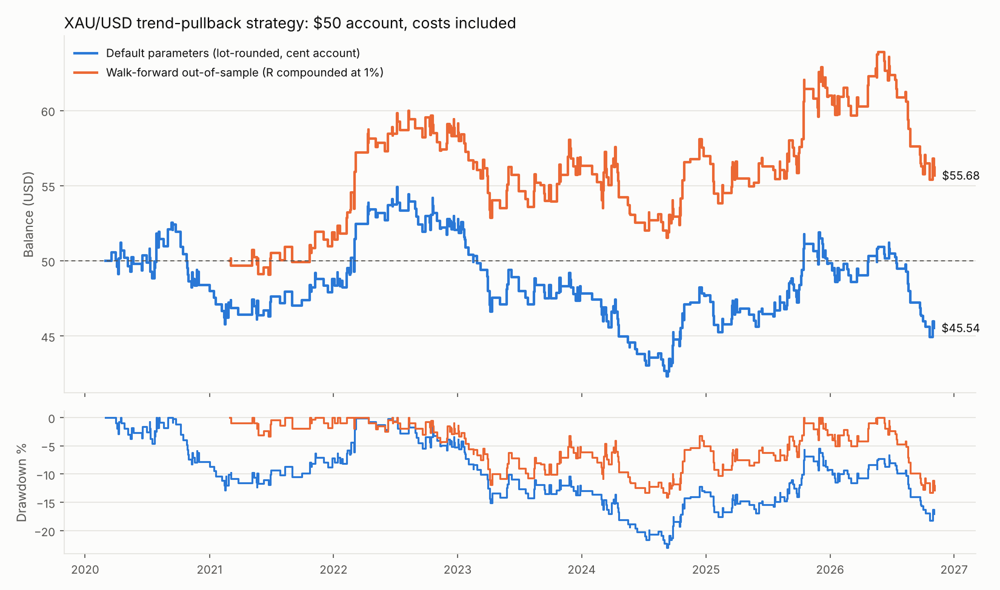

# GoldBot backtest report

Generated 2026-11-14 23:52 UTC. Symbol XAU/USD, data from twelvedata.

Period: **2020-03-01 to 2026-11-13** (6.7 years). Account type `cent`, starting balance $50, risk 1.0% per trade.

Costs: spread $0.30/oz, entry slippage $0.10, stop slippage $0.15, swap 6.0%/yr long, 1.0%/yr short.

## Data quality

- 15min: 157810/161000 expected bars present, 3190 missing (1.98%), largest gap 3 days 04:30:00
- 1h: 39513/40250 expected bars present, 737 missing (1.83%), largest gap 3 days 05:00:00
- 4h: 10690 bars cached

## Headline results

| Run | Trades | Win rate | PF | Exp. R | 95% CI (R) | Exp. $ | Max DD | Lose streak | Final $ |
|---|---|---|---|---|---|---|---|---|---|
| Defaults, development period | 304 | 39.1% | 1.01 | +0.026 | [-0.12, +0.17] | $+0.002 | 22.9% | 9 | $50.66 |
| Defaults, lockbox (last 12 months) | 55 | 29.1% | 0.67 | -0.230 | [-0.55, +0.11] | $-0.091 | 13.4% | 13 | $44.98 |
| Defaults, full period | 359 | 37.6% | 0.95 | -0.013 | [-0.14, +0.13] | $-0.012 | 22.9% | 13 | $45.54 |
| Walk-forward out-of-sample* | 279 | 39.4% | 1.08 | +0.048 | [-0.11, +0.20] | $+0.023 | 14.1% | 11 | $55.68 |

*Walk-forward balance uses the R-multiples compounded at the configured risk (no lot rounding).

## Full-period detail (default parameters)

| Metric | Value |
|---|---|
| Trades | 359 |
| Trades per month | 4.5 |
| Win rate | 37.6% |
| Profit factor | 0.95 |
| Expectancy per trade | -0.013 R  ($-0.012) |
| Average win / loss | +1.57 R / -0.96 R |
| Total | -4.7 R |
| Net P&L | $-4.46 (-8.9%) |
| Max drawdown | 22.9% ($12.59) |
| Longest losing streak | 13 |
| Final balance | $45.54 |

Exit reasons: SL 213, TP2 69, breakeven after TP1 34, time stop 20, weekend close 19, TP1 3, SL gap 1

By direction: BUY 249 trades, +0.037 R, SELL 110 trades, -0.126 R

| Year | Trades | Exp. R | Total R |
|---|---|---|---|
| 2020 | 53 | -0.078 | -4.2 |
| 2021 | 39 | +0.055 | +2.2 |
| 2022 | 57 | +0.136 | +7.8 |
| 2023 | 53 | -0.158 | -8.4 |
| 2024 | 54 | +0.012 | +0.6 |
| 2025 | 60 | +0.128 | +7.7 |
| 2026 | 43 | -0.243 | -10.5 |

Skipped signals: stop # ATR wider than max # (35), stopped for the day after # losses (2)

## Cost sensitivity (default parameters, full period)

| Run | Trades | Win rate | PF | Exp. R | 95% CI (R) | Exp. $ | Max DD | Lose streak | Final $ |
|---|---|---|---|---|---|---|---|---|---|
| No costs | 357 | 38.4% | 1.12 | +0.088 |  | $+0.040 | 14.9% | 13 | $64.15 |
| Base costs | 359 | 37.6% | 0.95 | -0.013 |  | $-0.012 | 22.9% | 13 | $45.54 |
| 2x costs | 360 | 35.8% | 0.78 | -0.116 |  | $-0.049 | 37.0% | 13 | $32.52 |

## Account type check (default parameters, full period)

| Account | Trades taken | SKIP: risk too high | Exp. R | Final $ |
|---|---|---|---|---|
| standard | 0 | 471 | +0.000 | $50.00 |
| micro | 245 | 155 | -0.061 | $41.48 |
| cent | 359 | 0 | -0.013 | $45.54 |

## Walk-forward folds

| Test window | Chosen on train | Train exp. R (n) | Test trades | Test exp. R |
|---|---|---|---|---|
| 2021-03-01..2021-06-01 | sl_atr_mult=1.5, rsi_pullback_level=45, pullback_bars=4 | -0.043 (57) | 8 | -0.211 |
| 2021-06-01..2021-09-01 | sl_atr_mult=1.5, rsi_pullback_level=45, pullback_bars=4 | -0.116 (55) | 7 | +0.391 |
| 2021-09-01..2021-12-01 | sl_atr_mult=1.5, rsi_pullback_level=45, pullback_bars=4 | -0.171 (44) | 5 | +0.577 |
| 2021-12-01..2022-03-01 | sl_atr_mult=1.5, rsi_pullback_level=45, pullback_bars=4 | +0.081 (30) | 10 | +0.502 |
| 2022-03-01..2022-06-01 | sl_atr_mult=1.5, rsi_pullback_level=45, pullback_bars=4 | +0.299 (30) | 11 | +0.545 |
| 2022-06-01..2022-09-01 | sl_atr_mult=1.5, rsi_pullback_level=45, pullback_bars=4 | +0.508 (33) | 11 | +0.165 |
| 2022-09-01..2022-12-01 | sl_atr_mult=2.0, rsi_pullback_level=45, pullback_bars=4 | +0.462 (36) | 11 | -0.152 |
| 2022-12-01..2023-03-01 | sl_atr_mult=2.0, rsi_pullback_level=45, pullback_bars=4 | +0.291 (42) | 18 | -0.168 |
| 2023-03-01..2023-06-01 | sl_atr_mult=2.0, rsi_pullback_level=45, pullback_bars=8 | +0.086 (59) | 14 | +0.039 |
| 2023-06-01..2023-09-01 | sl_atr_mult=2.0, rsi_pullback_level=45, pullback_bars=8 | -0.021 (62) | 8 | -0.226 |
| 2023-09-01..2023-12-01 | sl_atr_mult=2.0, rsi_pullback_level=45, pullback_bars=8 | -0.068 (58) | 15 | +0.202 |
| 2023-12-01..2024-03-01 | sl_atr_mult=2.0, rsi_pullback_level=45, pullback_bars=8 | -0.030 (58) | 11 | -0.450 |
| 2024-03-01..2024-06-01 | sl_atr_mult=2.0, rsi_pullback_level=45, pullback_bars=8 | -0.066 (48) | 22 | -0.074 |
| 2024-06-01..2024-09-01 | sl_atr_mult=2.0, rsi_pullback_level=45, pullback_bars=4 | -0.077 (39) | 7 | -0.268 |
| 2024-09-01..2024-12-01 | sl_atr_mult=2.0, rsi_pullback_level=45, pullback_bars=4 | -0.078 (38) | 15 | +0.594 |
| 2024-12-01..2025-03-01 | sl_atr_mult=1.5, rsi_pullback_level=45, pullback_bars=4 | +0.157 (43) | 11 | -0.363 |
| 2025-03-01..2025-06-01 | sl_atr_mult=2.0, rsi_pullback_level=45, pullback_bars=4 | +0.088 (45) | 11 | +0.125 |
| 2025-06-01..2025-09-01 | sl_atr_mult=1.5, rsi_pullback_level=45, pullback_bars=4 | +0.162 (45) | 11 | +0.234 |
| 2025-09-01..2025-12-01 | sl_atr_mult=1.5, rsi_pullback_level=45, pullback_bars=4 | +0.241 (49) | 17 | +0.603 |
| 2025-12-01..2026-03-01 | sl_atr_mult=1.5, rsi_pullback_level=45, pullback_bars=8 | +0.248 (58) | 20 | -0.178 |
| 2026-03-01..2026-06-01 | sl_atr_mult=1.5, rsi_pullback_level=45, pullback_bars=8 | +0.213 (65) | 9 | +0.655 |
| 2026-06-01..2026-09-01 | sl_atr_mult=1.5, rsi_pullback_level=45, pullback_bars=8 | +0.335 (61) | 16 | -0.638 |
| 2026-09-01..2026-11-13 | sl_atr_mult=1.5, rsi_pullback_level=45, pullback_bars=8 | +0.086 (65) | 11 | -0.303 |

